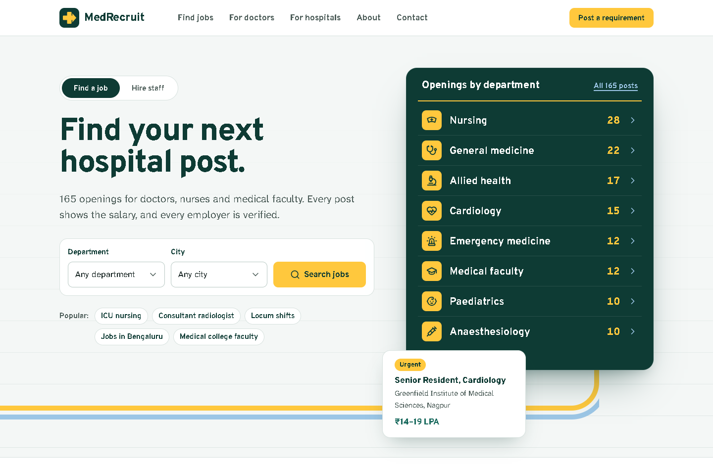

# MedRecruit: from brochure to job platform

> Draft case study. Replace the bracketed parts and rewrite in your own voice.

**Role:** [your role, e.g. design and front-end development]
**Tools:** React 19, TypeScript, Vite, React Router 7, CSS Modules, Playwright, Lighthouse
**Scope:** Seven routes, a design system, four forms, responsive from 360px to 1920px

## The starting point

The brief began as a single landing page mock-up ([01](case-study/01-reference-mockup.png)). I first built it as a pixel-faithful replica ([02](case-study/02-replica-1440.png)), with every section within 3px of the mock-up at 1440px. Building it closely exposed its problems:

- **Everything is too tight.** Gaps between sections are about 15px, and body text drops to 12px.
- **It's a brochure.** It describes the company, but a doctor can't search for a job and a hospital can't start a request.
- **It has about 11 calls to action.** Several lead to the same place.
- **Proof is thin.** Six generic "Why choose us" icons and unverified statistics.

## Goal

Turn the page into a product with two clear journeys:

1. **Doctors, nurses and faculty** find a post and apply.
2. **Hospitals and colleges** send a hiring requirement.

## Concept: hospital wayfinding

Every hospital guides people with a lobby directory board and colour-coded lines on the floor. The redesign uses that language. The hero *is* a directory board: departments listed with live opening counts, and each row opens filtered results. Floor tape runs out from under the board and continues through the site. Doctors' pages are marked in ceil blue, the colour of scrubs, and hospitals' pages in signal yellow.

The board is the only loud element. Everything else is calm, legible and led by data.

## Design decisions

- **Typography.** Overpass descends from Highway Gothic, the US road-sign typeface, so it reads as signage. Atkinson Hyperlegible Next was designed with the Braille Institute for low-vision readers, which matters for an audience that reads on night shifts.
- **Colour.** Theatre green is the dark green used in operating-theatre drapes. Signal yellow is the high-visibility colour of hospital signage. Ward white is a cool clinical background instead of the usual cream.
- **Jobs as a table, not cards.** Doctors compare salary, city and experience across posts, so the list is a real table with column headers. It uses container queries to become compact rows beside the filters and stacked rows on phones.
- **Data over adjectives.** Every post shows a salary band. The "verification" section shows a sample candidate file with each check, instead of a "trusted" badge.
- **Radius carries hierarchy.** Boards are 22px, panels 16px, controls 10px and chips are pills. Not everything gets the same rounded card.

## Key interactions

- An **audience switch** in the hero changes the headline, the form and the board's data (openings vs. available specialists).
- **Search state lives in the URL**, so every filtered search can be shared and bookmarked.
- A **three-step requirement form** has per-step validation and focus management, and is prefilled from the home page.
- **Accessible forms throughout:** errors appear on blur or submit, never while typing; focus moves to the first problem; hints and errors are linked with `aria-describedby`.

## Engineering notes worth discussing

- **A transition bug.** React Router 7 applies URL updates inside `startTransition`. Inputs bound directly to the URL lagged by a frame and could drop fast keystrokes. Filters now keep synchronous local state and mirror it to the URL. URL changes that come from links or the back button are still picked up.
- **A validation bug found by tests.** The phone check stripped a leading "91" as the country code, which rejected valid numbers like 91234 56780. Prefixes are now stripped only when the number has more than 10 digits.
- **Consistent sample data.** About 165 jobs are generated from realistic role templates with a seeded random generator. The board counts, filters and detail pages always agree.
- **Performance work.** Lighthouse first measured the home page at 89 for performance. Self-hosting the variable fonts took first paint from 3.0s to 2.0s, and responsive `srcset` images for the page intros added a few more points.

## Results

Measured with Lighthouse 12 (mobile preset) on the production build:

| | Performance | Accessibility | Best practices | SEO |
| --- | --- | --- | --- | --- |
| Range across 7 pages | 92–97 | 100 | 100 | 100 |

A 40-step Playwright suite covers search, filters, every form, keyboard access and the mobile menu. Layouts were checked at 375, 430, 768, 1024, 1280, 1440 and 1920px.

## What I would do next

- Usability test the two journeys with five doctors and five hospital HR staff.
- Connect a jobs API and the form endpoints.
- Add saved searches and job alerts for doctors.
- Measure the share of searches that end in an application, and the time from brief to shortlist.

## Screens

| | |
| --- | --- |
| Home (full page) | [03](case-study/03-redesign-home-1440.png) |
| Job search | [05](case-study/05-redesign-jobs-1440.png) |
| Job detail and application | [06](case-study/06-redesign-job-detail-1440.png) |
| Mobile | [07](case-study/07-redesign-mobile-375.png) |
